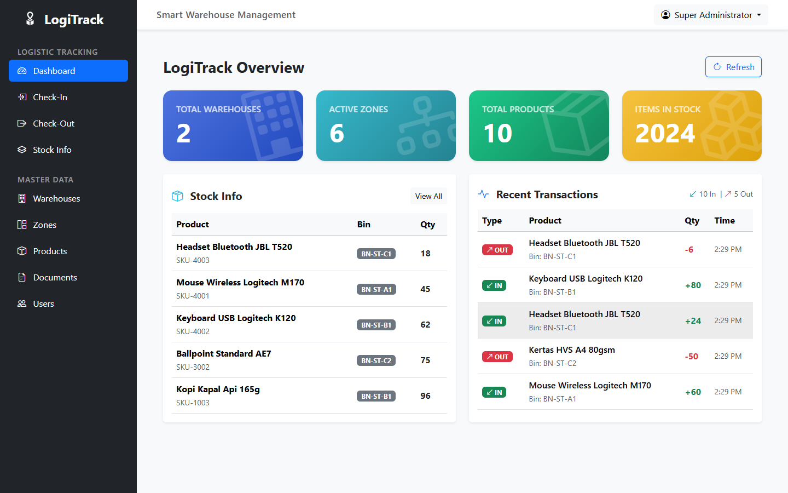
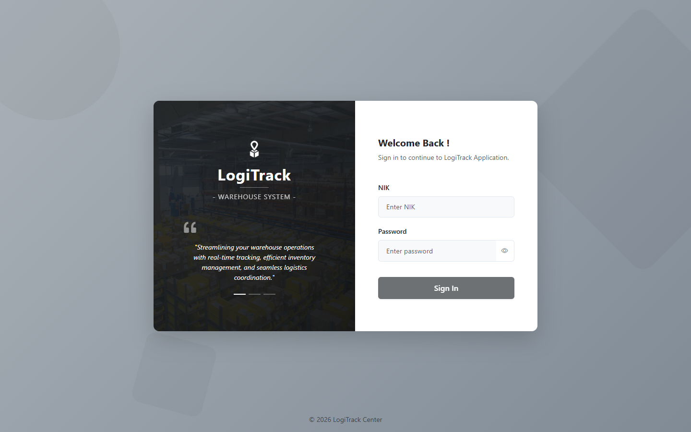
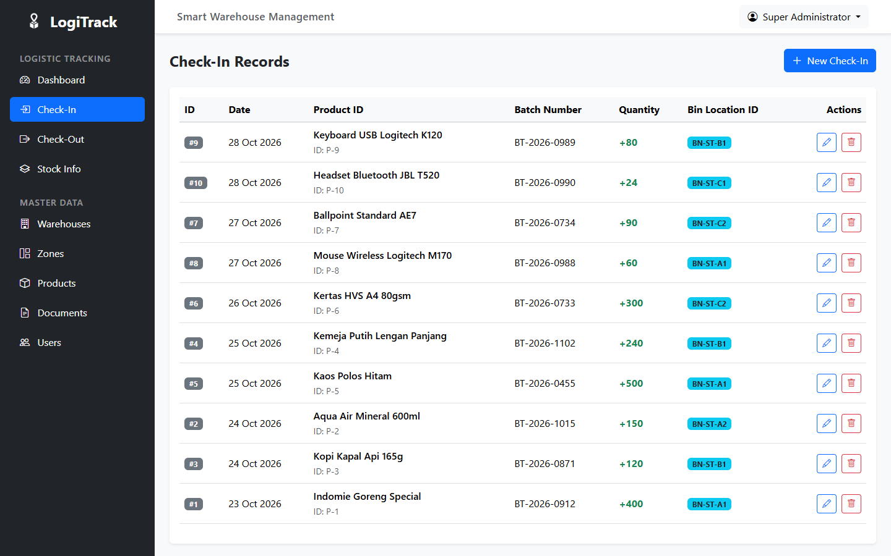
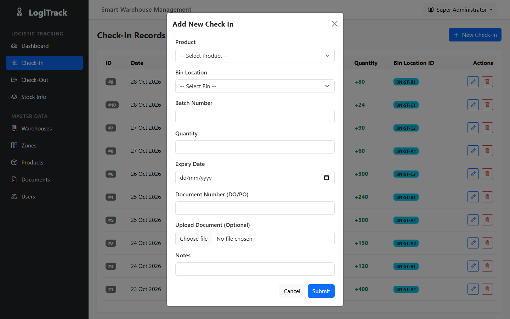
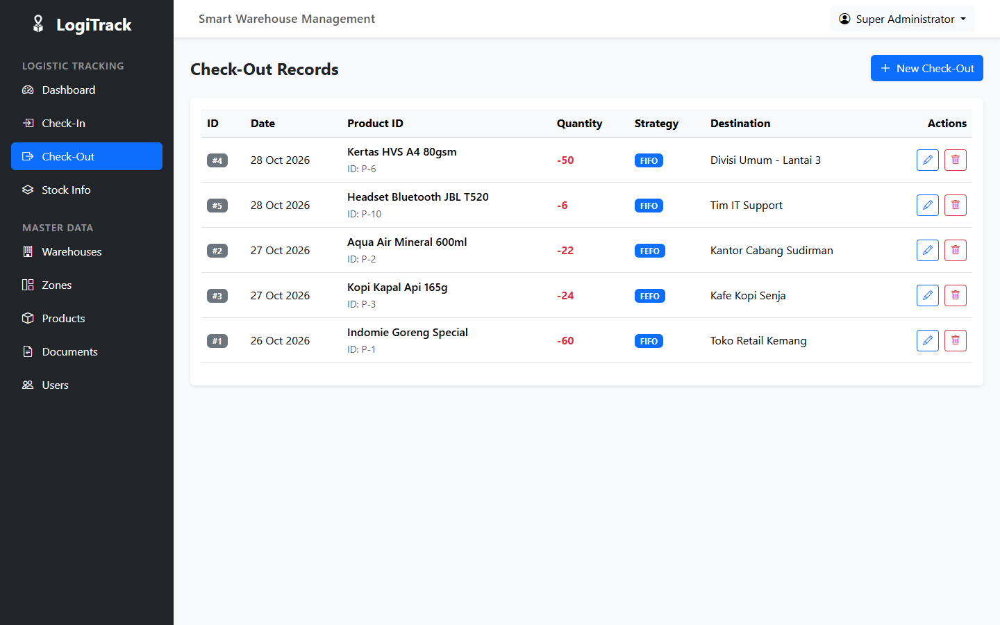
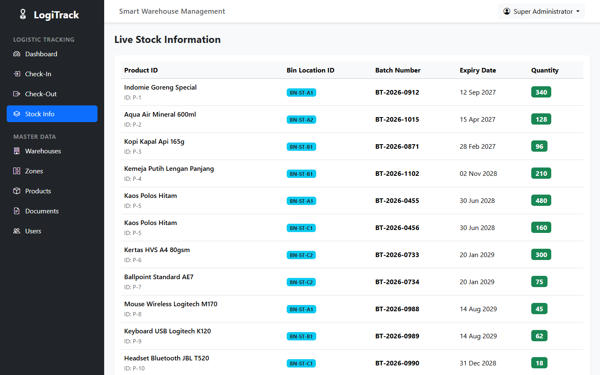
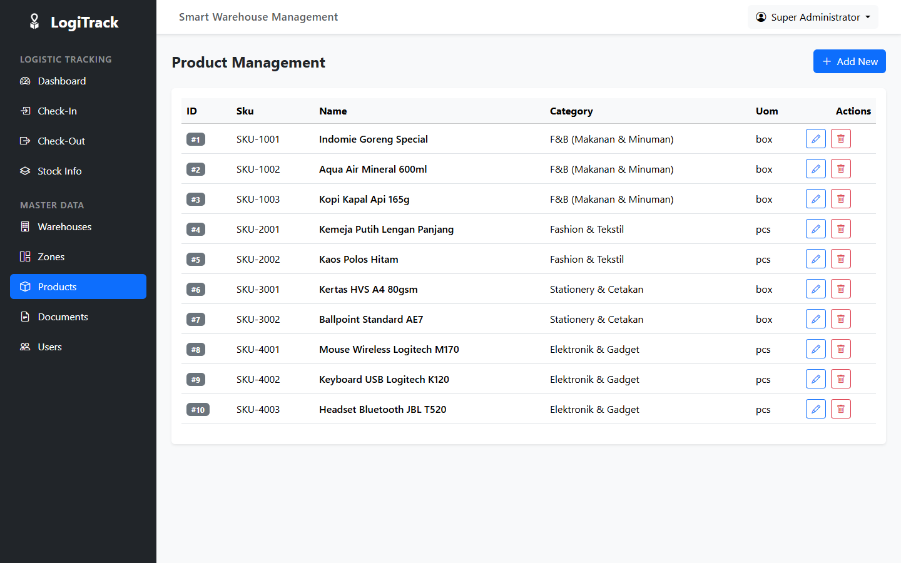
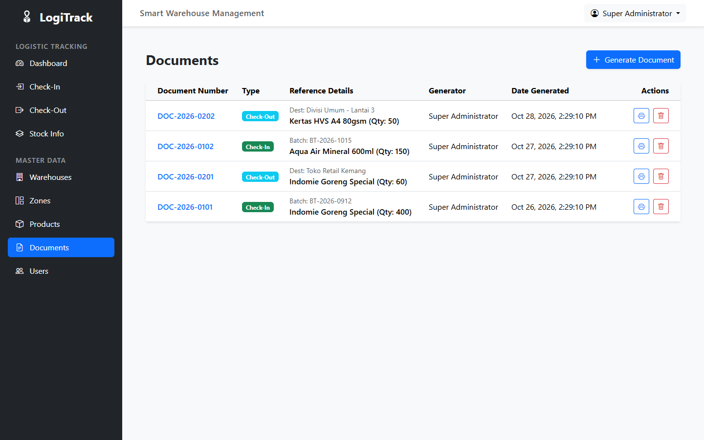
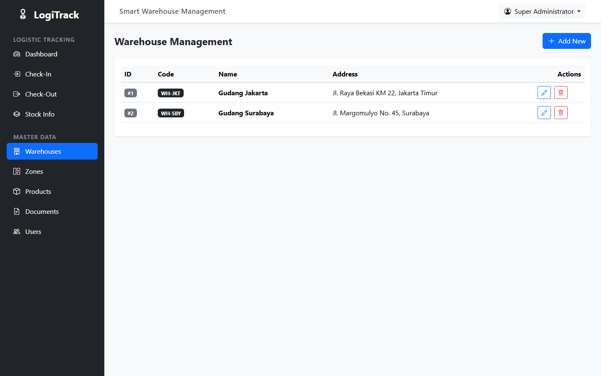
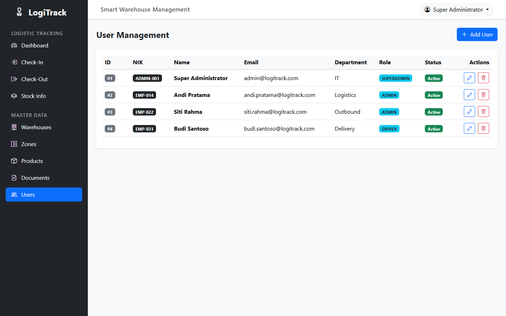

# LogiTrack — Warehouse Management System

Aplikasi web gudang: catat barang masuk dan keluar per batch, pantau stok per bin,
kelola master data gudang, lalu terbitkan dokumen transaksinya. Setiap transaksi
tercatat sebagai pergerakan stok, jadi jumlah di dashboard selalu ikut berubah.

## Fitur

- **Check-in barang** — catat kedatangan per batch: produk, bin, jumlah, tanggal
  kedaluwarsa, supplier, nomor dokumen DO/PO, dan lampiran berkas. Stok langsung
  bertambah di bin yang dipilih.
- **Check-out barang** — pengeluaran per batch dengan strategi FIFO atau FEFO,
  tujuan pengiriman, dan nomor dokumen. Stok dipotong dari batch yang paling tepat
  dan ditolak kalau jumlahnya tidak cukup.
- **Stok per bin** — lihat sisa stok tiap batch beserta bin location dan tanggal
  kedaluwarsanya.
- **Master data** — gudang, zona (inbound, storage, outbound, quarantine, staging),
  bin location, dan produk per kategori serta satuan.
- **Dokumen** — terbitkan dokumen dari transaksi check-in/check-out, cetak, dan
  tandai statusnya (generated, printed, cancelled).
- **Pengguna & peran** — kelola akun admin, superadmin, dan driver. NIK dan data
  karyawan diambil dari database HR yang sama dengan aplikasi lain.

## Alur kerja

1. **Masuk** — login memakai NIK karyawan.
2. **Check-in** — pilih produk dan bin, isi batch, jumlah, dan tanggal
   kedaluwarsa. Stok serta pergerakan masuk tercatat.
3. **Check-out** — pilih produk dan jumlah, tentukan FIFO/FEFO dan tujuan. Stok
   dipotong dari batch tertua atau yang paling dekat kedaluwarsa.
4. **Pantau & cetak** — dashboard merangkum gudang dan transaksi terakhir;
   dokumen transaksi bisa dicetak dari menu Documents.

## Tangkapan layar

| Masuk | Dashboard |
| --- | --- |
|  |  |

| Check-in barang | Form check-in |
| --- | --- |
|  |  |

| Check-out barang | Stok per bin |
| --- | --- |
|  |  |

| Master produk | Dokumen transaksi |
| --- | --- |
|  |  |

| Master gudang | Pengguna & peran |
| --- | --- |
|  |  |

## Stack

Angular 18 · Bootstrap 5 · RxJS · SweetAlert2 · Bootstrap Icons.
Autentikasi memakai cookie JWT dari backend (`withCredentials`), jadi tidak ada
token yang disimpan di browser.

Backend (Express + Sequelize + MySQL) ada di repo terpisah:
**[logitrack-be](https://github.com/SyahidanNJ/logitrack-be)**.
